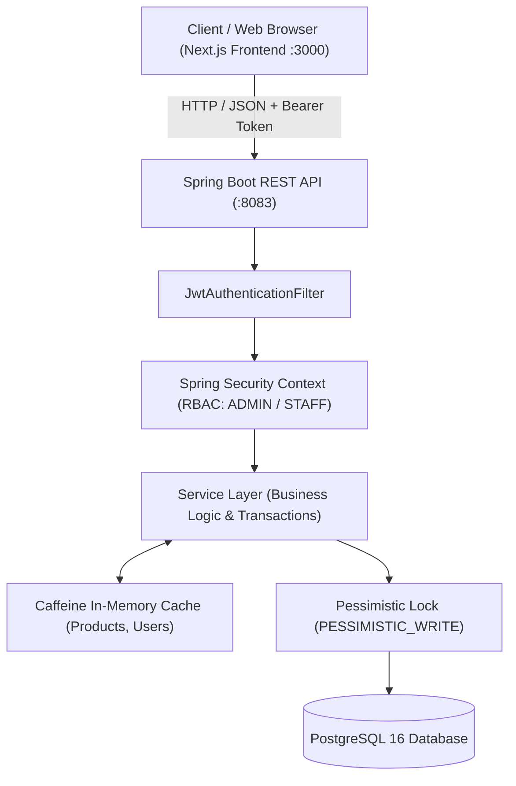
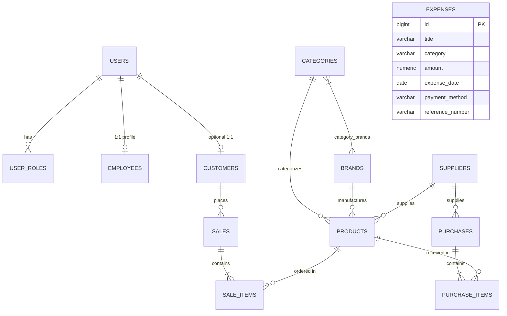

# Computer Ecommerce & Shop Management System

A high-performance, enterprise-grade Computer Shop & Ecommerce Management System built with **Spring Boot**, **PostgreSQL**, **Flyway**, **Spring Security (Stateless JWT)**, and **Next.js**.

---

## Table of Contents

- [Overview](#overview)
- [Verification & Build Status](#verification--build-status)
- [Technology Stack](#technology-stack)
- [System Architecture](#system-architecture)
- [Database Schema & Migrations](#database-schema--migrations)
- [Security & Authentication](#security--authentication)
- [Complete API Reference](#complete-api-reference)
  - [1. Authentication](#1-authentication)
  - [2. Products Catalog](#2-products-catalog)
  - [3. Categories](#3-categories)
  - [4. Brands](#4-brands)
  - [5. Inventory Management](#5-inventory-management)
  - [6. Customers](#6-customers)
  - [7. Employees](#7-employees)
  - [8. Expenses & Financial Tracking](#8-expenses--financial-tracking)
  - [9. Sales & POS Checkout](#9-sales--pos-checkout)
- [Concurrency & Data Integrity](#concurrency--data-integrity)
- [Environment Variables](#environment-variables)
- [Getting Started & Installation](#getting-started--installation)
  - [Option A: Docker Compose (Recommended)](#option-a-docker-compose-recommended)
  - [Option B: Local Backend Development](#option-b-local-backend-development)
  - [Option C: Next.js Frontend Development](#option-c-nextjs-frontend-development)
- [Project Directory Layout](#project-directory-layout)
- [Roadmap & Planned Modules](#roadmap--planned-modules)

---

## Overview

This repository provides an end-to-end commerce solution featuring:
- **Spring Boot Backend (`8083`)**: RESTful API managing catalog, inventory, sales, customer/employee identity, expenses, and transaction safety.
- **Next.js Frontend (`3000`)**: Modern web UI created with React 19, TypeScript, and Tailwind CSS v4.
- **Relational PostgreSQL Database**: Version-controlled migrations using Flyway.
- **Role-Based Access Control (RBAC)**: Fine-grained security for `ADMIN` and `STAFF` roles using stateless JWT.

---

## Verification & Build Status

The Spring Boot project has been compiled, packaged, and verified through automated test suites:

| Check | Tool / Command | Result | Details |
| :--- | :--- | :--- | :--- |
| **Compilation & Tests** | `./mvnw test` | **PASSED** | 3/3 tests executed without failure or error (`CategoryBrandProductIntegrationTest`, `ExpenseIntegrationTest`, `ComputerEcommerceApplicationTests`). |
| **Package JAR Build** | `./mvnw package -DskipTests` | **PASSED** | Generated production fat JAR: `target/computer_ecommerce-0.0.1-SNAPSHOT.jar`. |
| **Java Platform** | OpenJDK 21 (Temurin) | **VERIFIED** | Bytecode targeted for Java 21 virtual machine. |
| **Test Database** | In-Memory H2 (`PostgreSQL` mode) | **VERIFIED** | Fast, isolated testing with `create-drop` schema and disabled Flyway in `application-test.yml`. |

---

## Technology Stack

### Backend Stack
- **Framework**: Spring Boot 4.1.1 (Spring Framework 7 / Jakarta EE 11)
- **Language**: Java 21
- **Database & Persistence**:
  - PostgreSQL 16 (production/dev)
  - Spring Data JPA / Hibernate ORM 7.4.5.Final
  - Flyway 10.x Database Migrations
  - H2 Database (unit & integration testing)
- **Security**: Spring Security 6, Stateless JWT (`io.jsonwebtoken:jjwt` 0.12.6), BCrypt Password Hashing
- **Caching**: Caffeine Cache (`products`, `users` - 5-minute TTL, max 1000 items)
- **DTO Mapping**: ModelMapper 3.2.2
- **Validation**: Hibernate Validator (`jakarta.validation`)
- **Containerization**: Docker multi-stage build (`eclipse-temurin:21-jre`)

### Frontend Stack (`/frontend`)
- **Framework**: Next.js 16.4.2 (App Router)
- **Library**: React 19.3.0
- **Styling**: Tailwind CSS v4 (with `@tailwindcss/turbopack`)
- **Language**: TypeScript 5

---

## System Architecture



---

## Database Schema & Migrations

Database evolution is managed via **Flyway** in `src/main/resources/db/migration`:

| Version | Migration Script | Description |
| :--- | :--- | :--- |
| **V1** | `V1__create_users.sql` | `users` (accounts, BCrypt passwords) and `user_roles` (element collection). |
| **V2** | `V2__create_products.sql` | `suppliers` and `products` tables (SKU, pricing, stock count, active status). |
| **V3** | `V3__create_customers_employees.sql` | `customers` (optional user link) and `employees` (mandatory 1:1 user link). |
| **V4** | `V4__create_sales_purchases.sql` | `sales`, `sale_items` (composite PK), `purchases`, and `purchase_items`. |
| **V5** | `V5__create_categories_and_brands.sql` | `brands`, `categories`, `category_brands` (M:N join table), and foreign key alterations on `products`. |
| **V6** | `V6__create_expenses.sql` | `expenses` table for store overhead, utilities, rent, and payroll tracking. |

### Entity-Relationship Diagram



---

## Security & Authentication

- **Stateless JWT Flow**: Clients authenticate with `POST /api/auth/login`. Successful authentication returns a signed HMAC-SHA256 JWT containing the username.
- **Authorization Header**: For all secured endpoints, provide the token:
  ```http
  Authorization: Bearer <your_jwt_token>
  ```
- **Role Hierarchy**:
  - `ADMIN`: Full access to create, update, delete, view all domains, customers, employees, inventory adjustments, and expenses.
  - `STAFF`: Read catalog, brands, categories, inventory, create sales, and view expenses.
  - `CUSTOMER`: Default role assigned to all registered customer users.
- **Admin Bootstrapping (`AdminInitializer`)**: When `ADMIN_ENABLED=true` in `.env`, Spring Boot automatically initializes an admin account on startup with the configured `ADMIN_USERNAME`, `ADMIN_PASSWORD`, and `ADMIN_EMAIL`.

---

## Clerk Authentication & Default Customer Role

The Next.js frontend (`/frontend`) is integrated with **Clerk Auth** for modern, secure user identity and authentication.

### Default Role Assignment on Registration (`customer`)

When a user signs up/registers through Clerk, they automatically receive the **`customer`** role via a robust **dual-layer assignment architecture**:

1. **Layer 1: Clerk Webhook Handler (`/api/webhooks/clerk`)**:
   - Listens for Clerk's `user.created` event.
   - Automatically updates the user's `publicMetadata` in Clerk via `clerkClient().users.updateUserMetadata()`:
     ```json
     {
       "publicMetadata": {
         "role": "customer"
       }
     }
     ```
   - Signature verification is handled securely via `svix`.

2. **Layer 2: Zero-Delay Session Synchronization (`lib/auth.ts`)**:
   - When an authenticated user visits the application, `getOrSetUserRole()` checks whether `user.publicMetadata.role` is populated.
   - If not yet set (e.g. during local development without a public webhook tunnel), it immediately updates the Clerk user's metadata with `role: "customer"`.
   - This ensures **100% reliability** in both local development and production environments.

### Storefront & Customer Routes
- **Storefront Home**: `/` (`frontend/app/page.tsx`)
- **Order Tracking**: `/orders` (`frontend/app/orders/page.tsx`)
- **Customer Dashboard**: `/dashboard` (`frontend/app/dashboard/page.tsx`)
- **Sign In**: `/sign-in` (`frontend/app/sign-in/[[...sign-in]]/page.tsx`)
- **Sign Up**: `/sign-up` (`frontend/app/sign-up/[[...sign-up]]/page.tsx`)
- **Webhook Endpoint**: `/api/webhooks/clerk` (`frontend/app/api/webhooks/clerk/route.ts`)
- **Next.js Proxy/Middleware**: `frontend/proxy.ts` protects private routes while allowing public access to `/`, `/orders`, `/sign-in`, `/sign-up`, and `/api/webhooks`.

---

## Complete API Reference

Base URL: `http://localhost:8083`

### 1. Authentication

| Method | Endpoint | Access | Description |
| :--- | :--- | :--- | :--- |
| `POST` | `/api/auth/login` | Public | Authenticate user credentials and receive JWT |

#### Request Payload:
```json
{
  "username": "admin",
  "password": "admin123"
}
```

#### Response Payload (`200 OK`):
```json
{
  "token": "eyJhbGciOiJIUzI1NiIsInR5cCI6IkpXVCJ9...",
  "username": "admin",
  "role": "ADMIN"
}
```

---

### 2. Products Catalog

| Method | Endpoint | Access | Description |
| :--- | :--- | :--- | :--- |
| `GET` | `/api/products` | Public | List products (supports `?categoryId=1` and `?brandId=1` query parameters) |
| `GET` | `/api/products/{id}` | Public | Get product details by ID |
| `POST` | `/api/products` | `ADMIN` | Create new product |
| `PUT` | `/api/products/{id}` | `ADMIN` | Update product details |
| `DELETE` | `/api/products/{id}` | `ADMIN` | Delete product |

#### Create / Update Request Payload:
```json
{
  "sku": "LAPTOP-001",
  "name": "Gaming Laptop Pro",
  "description": "High-performance gaming laptop with RTX 4080",
  "price": 1499.99,
  "quantityOnHand": 25,
  "categoryId": 1,
  "brandId": 1
}
```

#### Response Payload (`200 OK`):
```json
{
  "id": 1,
  "sku": "LAPTOP-001",
  "name": "Gaming Laptop Pro",
  "description": "High-performance gaming laptop with RTX 4080",
  "price": 1499.99,
  "quantityOnHand": 25,
  "active": true,
  "categoryId": 1,
  "categoryName": "Laptops",
  "brandId": 1,
  "brandName": "Apple"
}
```

---

### 3. Categories

| Method | Endpoint | Access | Description |
| :--- | :--- | :--- | :--- |
| `GET` | `/api/categories` | `ADMIN`, `STAFF` | List all categories with associated brands |
| `GET` | `/api/categories/{id}` | `ADMIN`, `STAFF` | Get single category |
| `POST` | `/api/categories` | `ADMIN` | Create new category |
| `PUT` | `/api/categories/{id}` | `ADMIN` | Update category |
| `DELETE` | `/api/categories/{id}` | `ADMIN` | Delete category |
| `POST` | `/api/categories/{id}/brands/{brandId}` | `ADMIN` | Link brand to category |
| `DELETE`| `/api/categories/{id}/brands/{brandId}` | `ADMIN` | Unlink brand from category |

#### Create Category Request Payload:
```json
{
  "name": "Laptops",
  "description": "Portable notebooks and ultrabooks",
  "brandIds": [1, 2]
}
```

---

### 4. Brands

| Method | Endpoint | Access | Description |
| :--- | :--- | :--- | :--- |
| `GET` | `/api/brands` | `ADMIN`, `STAFF` | List all brands |
| `GET` | `/api/brands/{id}` | `ADMIN`, `STAFF` | Get brand by ID |
| `POST` | `/api/brands` | `ADMIN` | Create new brand |
| `PUT` | `/api/brands/{id}` | `ADMIN` | Update brand details |
| `DELETE` | `/api/brands/{id}` | `ADMIN` | Delete brand |

#### Create Brand Request Payload:
```json
{
  "name": "ASUS",
  "description": "ASUS Computer Hardware and Electronics",
  "categoryIds": [1]
}
```

---

### 5. Inventory Management

| Method | Endpoint | Access | Description |
| :--- | :--- | :--- | :--- |
| `GET` | `/api/inventory` | `ADMIN`, `STAFF` | View stock levels across all products |
| `GET` | `/api/inventory/{productId}` | `ADMIN`, `STAFF` | Get stock level for a product |
| `POST` | `/api/inventory` | `ADMIN` | Set stock quantity for a product |
| `PUT` | `/api/inventory/{productId}` | `ADMIN` | Update stock quantity |
| `DELETE` | `/api/inventory/{productId}` | `ADMIN` | Reset stock quantity to 0 |

#### Update Inventory Request Payload:
```json
{
  "quantityOnHand": 45
}
```

---

### 6. Customers

| Method | Endpoint | Access | Description |
| :--- | :--- | :--- | :--- |
| `GET` | `/api/customers` | `ADMIN` | List all customers |
| `GET` | `/api/customers/{id}` | `ADMIN` | Get customer by ID |
| `POST` | `/api/customers` | `ADMIN` | Create new customer record |
| `PUT` | `/api/customers/{id}` | `ADMIN` | Update customer record |
| `DELETE` | `/api/customers/{id}` | `ADMIN` | Delete customer record |

#### Create Customer Request Payload:
```json
{
  "userId": 1,
  "firstName": "Sok",
  "lastName": "Dara",
  "phone": "+85512345678"
}
```

---

### 7. Employees

| Method | Endpoint | Access | Description |
| :--- | :--- | :--- | :--- |
| `GET` | `/api/employees` | `ADMIN` | List all employee records |
| `GET` | `/api/employees/{id}` | `ADMIN` | Get employee by ID |
| `POST` | `/api/employees` | `ADMIN` | Create employee record (requires existing `userId`) |
| `PUT` | `/api/employees/{id}` | `ADMIN` | Update employee record |
| `DELETE` | `/api/employees/{id}` | `ADMIN` | Delete employee record |

#### Create Employee Request Payload:
```json
{
  "userId": 2,
  "firstName": "Vathana",
  "lastName": "Roeun",
  "jobTitle": "Store Manager"
}
```

---

### 8. Expenses & Financial Tracking

| Method | Endpoint | Access | Description |
| :--- | :--- | :--- | :--- |
| `GET` | `/api/expenses` | `ADMIN`, `STAFF` | List expenses (filter by `category`, `startDate`, `endDate`) |
| `GET` | `/api/expenses/{id}` | `ADMIN`, `STAFF` | Get expense details by ID |
| `GET` | `/api/expenses/total` | `ADMIN`, `STAFF` | Calculate total expenses (filter by `startDate`, `endDate`) |
| `POST` | `/api/expenses` | `ADMIN` | Record new expense |
| `PUT` | `/api/expenses/{id}` | `ADMIN` | Update expense record |
| `DELETE` | `/api/expenses/{id}` | `ADMIN` | Delete expense record |

#### Create Expense Request Payload:
```json
{
  "title": "Shop Electricity Bill",
  "category": "Utilities",
  "amount": 150.00,
  "expenseDate": "2026-10-20",
  "paymentMethod": "CASH",
  "referenceNumber": "INV-1029",
  "description": "Electricity bill for October"
}
```

---

### 9. Sales & POS Checkout

| Method | Endpoint | Access | Description |
| :--- | :--- | :--- | :--- |
| `POST` | `/api/sales` | `ADMIN`, `STAFF` | Complete checkout transaction and decrement stock |

> [!NOTE]
> Creating a sale requires the authenticated user account to be linked to an active `Employee` record.

#### Checkout Request Payload:
```json
{
  "customerId": 1,
  "items": [
    {
      "productId": 1,
      "quantity": 2
    }
  ]
}
```

#### Checkout Response Payload (`200 OK`):
```json
{
  "saleId": 101,
  "saleDate": "2026-10-22T09:18:25.588Z",
  "totalAmount": 2999.98,
  "items": [
    {
      "productId": 1,
      "productName": "Gaming Laptop Pro",
      "quantity": 2,
      "unitPrice": 1499.99,
      "subtotal": 2999.98
    }
  ]
}
```

---

## Concurrency & Data Integrity

1. **Pessimistic Locking (`PESSIMISTIC_WRITE`)**:
   During inventory modifications and sales transactions, products are selected using `findByIdForUpdate` to prevent lost updates when multiple staff members sell products simultaneously.
2. **Deadlock Prevention via Canonical Sorting**:
   In `SaleService`, items in a checkout request are sorted by `productId` before locks are acquired. This eliminates cyclical wait states across concurrent multi-product transactions.
3. **Atomic Stock Decrements**:
   If any product has insufficient stock or is marked inactive, the entire sales transaction rolls back cleanly.

---

## Environment Variables

Configure application settings in `.env` (copied from `.env.example`):

| Variable | Default Value | Description |
| :--- | :--- | :--- |
| `SERVER_PORT` | `8083` | Spring Boot server port |
| `DB_URL` | `jdbc:postgresql://localhost:5432/computer_ecommerce` | JDBC connection string |
| `DB_USERNAME` | `postgres` | Database username |
| `DB_PASSWORD` | `postgres` | Database password |
| `POSTGRES_DB` | `computer_ecommerce` | Docker PostgreSQL database name |
| `POSTGRES_USER` | `postgres` | Docker PostgreSQL username |
| `POSTGRES_PASSWORD`| `postgres` | Docker PostgreSQL password |
| `JWT_SECRET` | `MDEyMzQ1Njc4OWFiY2RlZjAxMjM0NTY3ODlhYmNkZWY=` | Base64-encoded secret key (min 32 bytes) |
| `JWT_ACCESS_EXPIRATION` | `900000` | JWT expiration time in milliseconds (15 mins) |
| `ADMIN_ENABLED` | `true` | Automatically seed admin account on startup |
| `ADMIN_USERNAME` | `admin` | Seeded admin username |
| `ADMIN_PASSWORD` | `admin123` | Seeded admin password |
| `ADMIN_EMAIL` | `admin@example.com` | Seeded admin email address |
| `SPRING_PROFILES_ACTIVE` | `dev` | Active Spring profile (`dev`, `prod`, `test`) |

---

## Getting Started & Installation

### Option A: Docker Compose (Recommended)

Run the entire backend ecosystem (PostgreSQL + Spring Boot application) with a single command:

```bash
# 1. Clone repository & configure environment
cp .env.example .env

# 2. Build and launch services
docker compose up --build
```
- PostgreSQL will be available on `localhost:5432`.
- Spring Boot API will be live on `http://localhost:8083`.

---

### Option B: Local Backend Development

#### Prerequisites
- **Java 21** (`java -version`)
- **PostgreSQL 16** running locally

#### Run Steps
```bash
# 1. Run all unit and integration tests
./mvnw test

# 2. Run Spring Boot application locally
./mvnw spring-boot:run
```

---

### Option C: Next.js Frontend Development

The frontend application is located in `/frontend`:

```bash
cd frontend

# Install dependencies (if not already installed)
npm install

# Start the development server with Turbopack
npm run dev
```

Visit `http://localhost:3000` to access the Next.js frontend.

---

## Project Directory Layout

```text
computer_ecommerce/
├── .env                              # Local environment variables
├── .env.example                      # Template environment variables
├── Dockerfile                        # Multi-stage container build
├── docker-compose.yml                # Multi-container orchestration (App + PostgreSQL)
├── pom.xml                           # Maven dependencies and build configuration
├── README.md                         # Comprehensive project documentation
├── docs/                             # Dedicated subsystem docs
│   ├── api-documentation.md          # Endpoint specifications
│   ├── database-design.md            # Schema and migration notes
│   └── setup-guide.md                # Detailed developer onboarding guide
├── frontend/                         # Next.js 16 + React 19 Frontend
│   ├── .env.local                    # Clerk API keys (Publishable, Secret)
│   ├── proxy.ts                      # Clerk authentication route proxy
│   ├── lib/
│   │   └── auth.ts                   # Role verification & auto customer provisioning
│   ├── app/                          # Next.js App Router
│   │   ├── layout.tsx                # Root layout with ClerkProvider
│   │   ├── page.tsx                  # Home portal with role badge & auth controls
│   │   ├── sign-in/[[...sign-in]]/   # Dedicated Sign In page
│   │   ├── sign-up/[[...sign-up]]/   # Dedicated Sign Up page (Customer role)
│   │   └── api/webhooks/clerk/       # Webhook for user.created role assignment
│   ├── package.json                  # Frontend scripts and dependencies
│   └── tsconfig.json                 # TypeScript configuration
└── src/
    ├── main/
    │   ├── java/com/example/computer_ecommerce/
    │   │   ├── ComputerEcommerceApplication.java
    │   │   ├── auth/                 # JWT Authentication & Login
    │   │   ├── brand/                # Brand management
    │   │   ├── category/             # Category management & M:N relations
    │   │   ├── common/               # Shared Enums (Role), Exceptions, Utils
    │   │   ├── config/               # SecurityConfig, AdminInitializer, ModelMapper
    │   │   ├── customer/             # Customer directory
    │   │   ├── employee/             # Employee management & user binding
    │   │   ├── expense/              # Expense tracking & aggregation
    │   │   ├── inventory/            # Stock level control
    │   │   ├── product/              # Product catalog & pessimistic lock repo
    │   │   ├── sales/                # Checkout transactions & order lines
    │   │   ├── security/             # JwtService, JwtFilter, UserDetailsService
    │   │   └── user/                 # AppUser entity & UserRepository
    │   └── resources/
    │       ├── application.yml       # Base configuration
    │       ├── application-dev.yml   # Dev profile (SQL formatting & debug logging)
    │       ├── application-prod.yml  # Production settings
    │       └── db/migration/         # Flyway SQL migrations (V1 to V6)
    └── test/
        ├── java/com/example/computer_ecommerce/
        │   ├── ComputerEcommerceApplicationTests.java
        │   ├── expense/ExpenseIntegrationTest.java
        │   └── product/CategoryBrandProductIntegrationTest.java
        └── resources/
            └── application-test.yml  # Test profile (H2 in-memory DB)
```

---

## Roadmap & Planned Modules

The architecture includes dedicated modular packages ready for subsequent phases:
- [ ] **Purchases & Supplier Management** (`com.example.computer_ecommerce.purchase`, `supplier`): Complete supplier order cycle and automated restock upon delivery.
- [ ] **Payment Gateways** (`com.example.computer_ecommerce.payment`): Integration with online payment providers (KHQR, Stripe, PayPal).
- [ ] **Reporting & Analytics** (`com.example.computer_ecommerce.report`): Daily, monthly revenue, profit/loss margin, and top-selling products.
- [ ] **Audit Trail** (`com.example.computer_ecommerce.audit`): Change history for catalog pricing and inventory adjustments.
- [ ] **Notifications** (`com.example.computer_ecommerce.notification`): Low stock alerts and sales invoice notifications.
# computer-store
